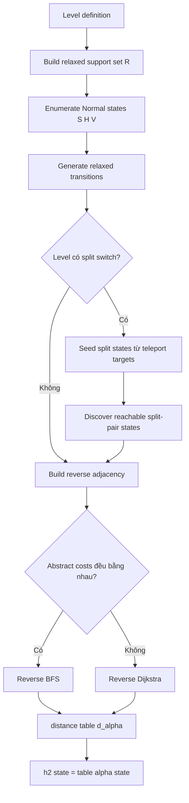
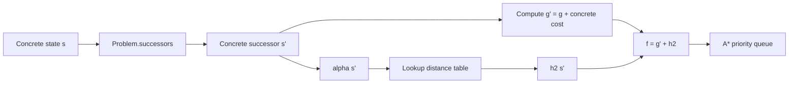

# Thiết kế heuristic `h2` hoàn chỉnh cho Bloxorz Solver: Orientation-Aware Relaxed Shortest-Path

> **Ghi chú đồng bộ (2026-10-26):** Đây là tài liệu nghiên cứu H2 duy nhất của repo. `solvers/heuristics/h2.py` cài **Variant B** (giữ split teleport và cặp cube) của báo cáo này. Trước khi trích dẫn, hãy đọc mục "Điều chỉnh khi cài đặt (đối chiếu với code)" ngay dưới đây. Mục đó ghi lại những chỗ code khác báo cáo (cost, kiến trúc) và cho biết phần nào dùng được cho report. Các ý còn dùng được từ tài liệu cũ `docs/h2 heuristic research.md` (đã xoá) cũng được chuyển vào mục này.

## Điều chỉnh khi cài đặt (đối chiếu với code)

### Phần của báo cáo mà code dùng

| Báo cáo | Code (`solvers/heuristics/h2.py`) |
| --- | --- |
| \(\alpha(s)=(r,c,o)\) cho block thường | `AbstractPose(position, orientation)` |
| \(\alpha(s)=\{p_1,p_2\}\) khi split, bỏ `active_cube` | `AbstractSplitPair(first, second)`, hai ô được sắp xếp canonical |
| Relaxed support \(R\): mọi ô khác VOID; fragile = floor; bridge luôn mở; bỏ hiệu ứng soft/heavy | `HeuristicContext.support_cells` do `Engine.get_heuristic_context()` tạo |
| Variant B: lăn đứng lên `P` → \(Q(t_1,t_2)\) với cost của cú lăn đó, không có cost teleport riêng | Cạnh trong `_build_abstract_graph`; nếu ô đích của split không thuộc \(R\) thì không tạo cạnh (concrete sẽ là `fall`) |
| Khi split, cho phép di chuyển cube nào cũng được; hai cube kề nhau thì tự ghép lại, anchor ở trên-trái | `_abstract_split_state`, `_merged_pose`, khớp với `split_block.try_merge` |
| Chỉ sinh các cặp cube đạt được từ `split_cells`, không lấy tích Descartes | Hàng đợi `pending` |
| Reverse search một lần, tra bảng \(O(1)\) | `reverse_dijkstra` + `lru_cache` theo `HeuristicContext` (benchmark gọi `clear_h2_cache()` trước mỗi lượt để đo lại preprocessing) |
| Abstract goal duy nhất là \(N(g_r,g_c,S)\) | `AbstractPose(goal, STANDING)` |

### Chỗ code khác báo cáo

1. **Cost không đồng nhất, dùng reverse Dijkstra thay cho BFS.** Lớp `LowerBoundCosts` trong báo cáo mặc định cost bằng 1.0. Code thì đặt trọng số cạnh **đúng bằng** `Engine.step_cost` với `CostConfig` mặc định:
   - lăn khi state nguồn đang `STANDING`: `stand_roll = 1.5`;
   - lăn khi state nguồn đang nằm: `lie_roll = 1.0`;
   - di chuyển một cube khi split: `stand_roll = 1.5`, vì concrete split state luôn có `orientation = STANDING`;
   - `SWITCH_CUBE` (0.1): không có cạnh, vì abstract state không đổi khi đổi cube điều khiển (cặp cube không có thứ tự). Do đó \(h(s)=h(s')\le 0.1+h(s')\);
   - `bridge_cross_penalty = 0.3` chưa được Engine dùng nên cũng không có trong H2.

   Tính cost cạnh theo orientation của state **nguồn** là cần thiết: nếu chỉ đếm số bước rồi nhân với \(\min(1.5, 1.0) = 1.0\) thì heuristic vẫn an toàn nhưng yếu hơn.
2. **Kiến trúc.** Báo cáo dùng adapter cho các repo khác (`Problem.result()`, Erroler). Repo này không có các adapter đó. Solver không đọc `engine.board`; Engine cung cấp snapshot bất biến `HeuristicContext(support_cells, goal, split_switches, stand_roll, lie_roll)`. A* dựng H2 một lần cho mỗi level và báo thời gian dựng riêng trong `SearchResult.preprocessing_time`, đúng như gợi ý ở mục "Preprocessing có tính vào Search Time không?".
3. **Giữ \(\infty\) cho ngõ cụt (từ 2026-10-26).** `H2Heuristic.__call__` trả \(d_\alpha\), bằng \(\infty\) khi abstract state không tới được goal. State có \(d_\alpha=\infty\) là **ngõ cụt thật**: ngay trên đồ thị nới lỏng cũng không tới được goal, nên concrete càng không tới được. A\* không đưa các state có \(h=\infty\) vào frontier; nếu initial state có \(h=\infty\) thì trả `solved = False` ngay. Bản trước đổi \(\infty\) thành `0`. Cách đó vẫn admissible nhưng làm mất consistency ở các cạnh đi vào ngõ cụt (Nhận xét 3 bên dưới), nên đã bị bỏ.
4. **A\*** giữ `best_cost` (g-score) và cho phép reopen; goal test khi pop. Heuristic không được dùng làm điều kiện visited.

### Chứng minh bằng lập luận

Ký hiệu: \(S\) là tập concrete state, \(c(s,a,s')=\) `Engine.step_cost` \(\in\{1.5, 1.0, 0.1\}\), \(h^*(s)\) là chi phí tối ưu thật từ \(s\) tới goal (\(\infty\) nếu không tới được). Gọi \(G_\alpha\) là đồ thị abstract trong `_build_abstract_graph`, \(\alpha\) là ánh xạ trong `H2Heuristic.__call__`, và \(d_\alpha(x)\) là khoảng cách ngắn nhất từ \(x\) tới \(N(g,\text{STANDING})\) trên \(G_\alpha\) (reverse Dijkstra cho đúng giá trị này vì mọi trọng số \(>0\)).

**Bổ đề 1 (mô phỏng cạnh).** Với mọi transition `OK` \(s\xrightarrow{a}s'\):

- (a) nếu \(a=\) `SWITCH_CUBE` thì \(\alpha(s)=\alpha(s')\), vì cặp cube không có thứ tự và vị trí không đổi;
- (b) ngược lại, \(G_\alpha\) có cạnh \(\alpha(s)\to\alpha(s')\) với trọng số **đúng bằng** \(c(s,a,s')\).

*Chứng minh (b), theo từng nhánh của `Engine.transition`:*

1. **Lăn khối nguyên** \((p,o)\to(p',o')\) không chạm `P`. Concrete `OK` ⇒ mọi ô của \((p',o')\) được đỡ dưới bridge state hiện tại ⇒ không phải VOID ⇒ thuộc \(R\). Vậy \(N(p',o')\in\) `poses` và có cạnh với trọng số theo orientation nguồn, đúng như `step_cost`. Soft/heavy switch chỉ đổi bridge state, mà \(\alpha\) bỏ bridge state.
2. **Lăn đứng lên split switch `P`.** Concrete gọi `make_split_state(split_cells)`, rồi `try_merge`, rồi kiểm tra nền lần nữa. `OK` ⇒ hai ô đích được đỡ ⇒ thuộc \(R\). `_abstract_split_state` tạo đúng cặp canonical, hoặc đúng pose đã ghép (anchor trên-trái, cùng quy tắc `try_merge`). Cạnh có trọng số `stand_roll` vì nguồn đang đứng. Nằm ngang lên `P` không kích hoạt split ở cả hai phía.
3. **Di chuyển cube khi split.** Concrete chỉ di chuyển cube active. Abstract cho phép di chuyển cube nào cũng được, nên tập cạnh abstract **chứa** cạnh concrete. `cube_collision` (hai cube trùng ô) là `ILLEGAL` ở concrete và không có cạnh ở abstract. Sau khi di chuyển, concrete `try_merge` khớp với `_merged_pose`. Cube không kích hoạt split hay heavy switch. Trọng số `stand_roll` khớp `step_cost`, vì split state luôn có `orientation = STANDING`.
4. Cặp cube đạt được ở concrete luôn có trong `pending`: concrete chỉ vào split qua `split_cells` của một `P`, và `pending` đóng dưới mọi bước di chuyển cube.

Mọi ô fragile, bridge và switch đều thuộc \(R\), nên mọi chỗ concrete làm `FALL` chỉ khiến concrete có **ít** cạnh hơn abstract, không bao giờ nhiều hơn. ∎

**Mệnh đề 2 (H2 consistent và admissible).** Đặt \(h(s)=d_\alpha(\alpha(s))\), giữ nguyên \(\infty\). Đây đúng là hàm `H2Heuristic.__call__` mà A\* dùng. Khi đó:

- **Consistent.** Theo Bổ đề 1 và bất đẳng thức tam giác của đường đi ngắn nhất: \(h(s)\le w(\alpha(s),\alpha(s'))+h(s')=c(s,a,s')+h(s')\) ở trường hợp (b). Ở trường hợp (a), \(h(s)=h(s')\le 0.1+h(s')\). Quy ước \(\infty\le c+\infty\).
- **Goal.** Concrete goal là khối đứng tại \(g\) và không split, nên \(\alpha(\text{goal})=N(g,\text{STANDING})\) và \(h(\text{goal})=0\).
- **Admissible.** Lấy đường tối ưu \(s=s_0\to\dots\to s_k=\text{goal}\). Cộng dồn bất đẳng thức consistent dọc đường đi: \(h(s)\le\sum c_i+h(\text{goal})=h^*(s)\). Nếu \(h^*(s)=\infty\) thì hiển nhiên.
- **Hệ quả.** \(h(s)=\infty\Rightarrow h^*(s)=\infty\). Vậy A\* bỏ mọi state có \(h=\infty\), không đưa vào frontier, mà không mất lời giải. Với heuristic consistent, A\* tối ưu và mỗi state được pop lần đầu với g tối ưu; reopen vẫn được giữ nhưng không còn cần thiết. ∎

**Nhận xét 3 (vì sao không fallback \(\infty\to0\)).** Đặt \(\tilde h=d_\alpha\) nếu hữu hạn, ngược lại \(\tilde h=0\). Đây là bản cài đặt trước 2026-10-26.

- **Admissible.** Nếu \(d_\alpha\) hữu hạn thì \(\tilde h=h\le h^*\) theo Mệnh đề 2. Nếu \(d_\alpha=\infty\) thì \(\tilde h=0\le h^*\).
- **Không consistent.** Có thể tồn tại cạnh \(s\to s'\) với \(d_\alpha(s)\) hữu hạn và \(d_\alpha(s')=\infty\), tức state nguồn còn đường khác tới goal nhưng bước này đi vào ngõ cụt. Khi đó \(\tilde h(s)=d_\alpha(s)>c+0=c+\tilde h(s')\) bất cứ khi nào \(d_\alpha(s)>c\). Thực nghiệm trên bản cũ đo được 84 cạnh như vậy (`level15`: 60, `level17`: 24). Tất cả đều là cạnh **ghép khối** (split → merge) đi vào một pose ngõ cụt: `level15` \((3,3)\) HORIZONTAL, `level17` \((6,1)\) VERTICAL. Ngoài ra, A\* còn phải mở rộng các ngõ cụt đó với \(f=g\). ∎

Kết luận cho report: H2, đúng hàm A\* đang dùng, **được chứng minh bằng lập luận là admissible và consistent** (Mệnh đề 2). Thực nghiệm bên dưới xác nhận điều đó trên toàn bộ state đạt được của 120 case.

### Kiểm chứng thực nghiệm (2026-10-26)

Chạy `python -m experiments.verify_heuristic` trên 120 case của `experiments/test_set.json`. Script duyệt toàn bộ concrete state đạt được (115.043 state, 379.858 cạnh `OK`), tính \(h^*\) chính xác bằng reverse Dijkstra từ mọi goal state, rồi kiểm tra từng state và từng cạnh. Kết quả lưu ở `experiments/heuristic_check.csv`:

| Heuristic | \(h>h^*\) | \(h(s)>c+h(s')\) | \(h(\text{goal})\ne0\) |
| --- | --- | --- | --- |
| \(h=d_\alpha\) (`H2`, hàm A\* dùng) | 0 | 0 | 0 |
| H1 | 0 | 21 (GUI-008/009/010/015/017) | 0 |
| \(\tilde h\) (bản cũ, fallback \(\infty\to0\)) | 0 | 84: GUI-015 (`level15`) 60, GUI-017 (`level17`) 24 | 0 |

Dòng \(\tilde h\) là số đo trên bản cài đặt trước khi sửa, giữ lại để minh hoạ Nhận xét 3. Benchmark 120 case sau khi sửa (lượt `20261026T065916Z`): total cost của A\* trùng UCS ở mọi case. `status`, `expanded_nodes`, `solution_length` và `total_cost` trùng với lượt chạy trước khi sửa ở cả 480 dòng, tức trên bộ test này A\* không mở rộng state ngõ cụt nào trước khi tới goal.

### Baseline H1

`solvers/heuristics/h1.py`: \(h_1=\lceil \text{Manhattan(anchor, goal)}/2 \rceil\), và bằng 0 khi split. H1 chỉ dùng để so sánh với H2. Trên level có split switch, H1 **không được** dùng làm bằng chứng admissibility, vì teleport có thể đưa khối tới gần goal rẻ hơn khoảng cách Manhattan. Thực nghiệm trên 120 case không thấy vi phạm admissible, nhưng có 21 cạnh vi phạm consistent (đều ở level có split switch), nên H1 không consistent.

### Phần nên dùng / bỏ khi viết report

- **Dùng:** Tóm tắt điều hành; Định nghĩa toán học và các giả định; Variant B và "Soft/heavy switches khi split"; Preprocessing bằng reverse search và ví dụ corridor; Độ phức tạp; Chứng minh admissibility/consistency; "Tại sao fragile có thể bỏ?", "Tại sao bridges phải luôn open?", "Non-uniform costs", "Negative cost", "`active_cube`"; "Benchmark theo đúng rubric" và "Preprocessing có tính vào Search Time không?"; "Công thức nên viết trong report cuối cùng". Ghép thêm các điều chỉnh về cost ở mục này.
- **Bỏ hoặc chỉ tham khảo:** "Cài đặt Python hoàn chỉnh", "Cách build `AbstractLevel`", "Integration với `Problem.result()`" (code thật nằm ở `h2.py`); các mục về teleport riêng (repo không có ô teleport, chỉ có split switch); Variant A khi đứng một mình; "Tích hợp với các repo tham khảo". Ngoài ra cần xoá các dấu trích nguồn tự động bị lỗi (`fileciteturn…`, `citeturn…`) trước khi đưa vào report.

## Tóm tắt điều hành

Với đúng yêu cầu của đồ án Bloxorz của bạn, `h2` mình khuyên dùng **không nên là Euclidean distance, cũng không nên chỉ là Manhattan + orientation penalty**. Lựa chọn mạnh và “đẹp” hơn về mặt học thuật là:

\[
\boxed{
h_2(s)
=
d_{G_\alpha}\bigl(\alpha(s),\,G_\alpha^{goal}\bigr)
}
\]

Trong đó:

- \(s\) là **state thật** của game;
- \(\alpha(s)\) là phiên bản **trừu tượng hóa** của state;
- \(G_\alpha\) là một **đồ thị Bloxorz đơn giản hóa nhưng vẫn giữ orientation**;
- \(d_{G_\alpha}\) là **chi phí đường đi ngắn nhất** trong đồ thị trừu tượng từ state hiện tại đến trạng thái đứng trên goal.

Đây chính là tinh thần của abstraction-based heuristic: giải một bài toán trừu tượng dễ hơn, rồi dùng chi phí tối ưu của bài toán trừu tượng làm lower bound cho bài toán thật. Pattern database cũng chính là bảng tra được tiền xử lý chứa shortest distances từ abstract states tới abstract goal. citeturn12search0turn12search3

Đồ án của bạn đặc biệt phù hợp với cách này, bởi đề yêu cầu orientation là thành phần của state, state phải chứa trạng thái bridge, và A* phải có heuristic admissible/consistent đối với cost function. Đề cũng trực tiếp gợi ý relaxed shortest-path heuristic. Ngoài ra, đề có fragile tile, bridge, soft/heavy/split switches và split/rejoin, nên một Manhattan heuristic thuần túy sẽ rất dễ trở nên quá yếu hoặc thậm chí không admissible khi teleport tồn tại. fileciteturn0file0

**Thiết kế cuối cùng mình đề xuất:**

\[
\boxed{
\begin{aligned}
\alpha(s)
&=
\begin{cases}
(r,c,o) & \text{nếu block bình thường}\\
\{p_1,p_2\} & \text{nếu block đang split}
\end{cases}\\[4pt]
h_2(s)
&=
\operatorname{ShortestPathCost}_{G_\alpha}
\left(
\alpha(s),\;
(g_r,g_c,\mathrm{Standing})
\right)
\end{aligned}}
\]

`G_alpha` sẽ:

- **giữ chính xác orientation** và geometry của việc lăn block;
- giữ permanent void/out-of-board là không đi được;
- coi fragile tile như floor bình thường;
- coi mọi bridge là luôn mở;
- bỏ bridge configuration khỏi abstract state;
- bỏ hiệu ứng soft/heavy switches vì bridges đã luôn mở;
- **không được bỏ split teleport** nếu level thật có split switch;
- với split state, giữ vị trí cả hai cube nhưng bỏ `active_cube`, cho phép di chuyển cube nào cũng được;
- tự động rejoin khi hai cube nằm kề nhau;
- chỉ `Standing(goal)` mới là abstract goal.

Với unit cost \(c=1\), preprocessing dùng **reverse BFS**. Với non-uniform costs, dùng **reverse Dijkstra** với abstract edge cost luôn là lower bound của concrete edge cost.

Khi các điều kiện lower-bound được đảm bảo, heuristic này vừa:

\[
\boxed{\text{admissible}}
\]

vừa:

\[
\boxed{\text{consistent}}
\]

và vì nó giữ orientation nên thường mạnh hơn đáng kể so với:

\[
h_1(s)
=
\left\lceil
\frac{d_\text{Manhattan}}{2}
\right\rceil.
\]

Đây cũng là một cách rất tốt để viết phần A* trong report vì bạn có thể giải thích rõ **abstraction → preprocessing → pattern database → A\*** thay vì đưa ra một công thức heuristic “đoán”.

## Định nghĩa toán học và các giả định

Đề của bạn mô tả block \(1\times1\times2\), ba orientation, fragile tile, bridge, soft/heavy/split switch, bridge toggle/permanent, split thành hai cube và rejoin; đồng thời state thật phải chứa bridge configuration. Đề cũng cho phép bạn tự chọn cost function, nhưng heuristic phải admissible với chính cost function đó. fileciteturn0file0

Ta formalize bài toán thật là đồ thị có trọng số:

\[
G=(S,E,c)
\]

trong đó:

- \(S\): tập concrete states;
- \(E\subseteq S\times S\): các transition hợp lệ;
- \(c(s,s')\ge0\): cost của transition;
- \(T\subseteq S\): goal states.

Một concrete state đầy đủ có thể hình dung:

\[
s=
(
B,
M,
\beta,
a
)
\]

với:

- \(B\): cấu hình block/cubes;
- \(M\in\{\text{normal},\text{split}\}\);
- \(\beta\): bit-vector trạng thái open/closed của bridges;
- \(a\): cube đang active khi split.

Đây là phần **concrete state**; A* vẫn search trên state này.

### Biểu diễn normal block

Với normal block:

\[
N(r,c,o)
\]

trong đó:

\[
o\in
\{
S,H,V
\}
\]

với:

- \(S\): Standing;
- \(H\): Horizontal;
- \(V\): Vertical.

Ta dùng anchor canonical:

\[
Occ(N(r,c,S))=\{(r,c)\}
\]

\[
Occ(N(r,c,H))
=
\{(r,c),(r,c+1)\}
\]

\[
Occ(N(r,c,V))
=
\{(r,c),(r+1,c)\}.
\]

Như vậy cùng một physical position luôn chỉ có **một representation duy nhất**.

### Biểu diễn split block

Khi block bị split:

\[
Q(p_1,p_2)
\]

với:

\[
p_1,p_2\in\mathbb{Z}^2,
\quad
p_1\ne p_2.
\]

Ta canonicalize:

\[
p_1<p_2
\]

theo lexicographic order để:

\[
Q(p_1,p_2)
=
Q(p_2,p_1).
\]

Điểm này rất quan trọng để tránh search/PDB coi:

```text
cube A at (2,3), cube B at (5,7)
```

và:

```text
cube A at (5,7), cube B at (2,3)
```

là hai abstract states khác nhau.

### Relaxed support set

Đặt:

\[
R=
\{
\text{mọi cell có thể được coi là support trong abstraction}
\}.
\]

Trong `h2` này:

\[
R=
Floor
\cup Goal
\cup Fragile
\cup Switches
\cup Bridges.
\]

Còn:

\[
Void\notin R.
\]

Nói cách khác:

| Concrete feature | Trong \(G_\alpha\) |
|---|---|
| Normal floor | giữ |
| Goal | giữ |
| Permanent void | vẫn cấm |
| Out-of-board | vẫn cấm |
| Fragile | coi như floor |
| Closed bridge | coi như open |
| Open bridge | open |
| Soft switch | coi như floor |
| Heavy switch | coi như floor |
| Bridge toggle | bỏ qua |
| Bridge permanent action | bỏ qua |
| Orientation | **giữ** |
| Split teleport | **giữ** |
| Split/rejoin | **giữ** |
| Active cube | bỏ |

Việc bỏ các constraints tạo ra các đường đi “dễ hơn”, thậm chí có thể tạo abstract paths không thể thực hiện trong concrete problem; đây là hành vi tự nhiên của abstraction và chính việc abstract problem dễ hơn mới cho lower bound. Literature về abstraction search cũng lưu ý abstract spaces có thể chứa các đường đi không correspond trực tiếp với concrete path. citeturn12search0

### Ánh xạ abstraction

Định nghĩa:

\[
\alpha:S\rightarrow S_\alpha.
\]

Nếu state bình thường:

\[
\boxed{
\alpha(s)
=
N(r,c,o)
}
\]

tức bỏ:

- bridge configuration;
- switch history;
- các thông tin động không ảnh hưởng geometry đã giữ lại.

Nếu state split:

\[
\boxed{
\alpha(s)
=
Q(\min(p_1,p_2),\max(p_1,p_2))
}
\]

và bỏ `active_cube`.

Điều này có nghĩa hai concrete states:

\[
s_1=(N(3,4,H),\beta_1)
\]

\[
s_2=(N(3,4,H),\beta_2)
\]

với bridge configurations khác nhau đều map thành:

\[
\alpha(s_1)=\alpha(s_2)=N(3,4,H).
\]

Đây là relaxation có chủ ý.

### Công thức chính xác của `h2`

Abstract goal:

\[
t_\alpha
=
N(g_r,g_c,S).
\]

Đặt shortest-path distance:

\[
d_\alpha(q)
=
\min_{\pi:q\leadsto t_\alpha}
\sum_{e\in\pi}\bar c(e).
\]

Khi đó:

\[
\boxed{
h_2(s)=d_\alpha(\alpha(s)).
}
\]

Đây không còn là một “ước lượng khoảng cách hình học”; nó là **optimal cost-to-go của một phiên bản relaxed Bloxorz**.

Về khái niệm, đây tương đương một instance-specific pattern database: PDB là bảng tiền tính chứa shortest distances từ abstract states tới abstract goal states. citeturn12search3

### Các giả định cần ghi trong report

Để định nghĩa không mơ hồ, mình khuyên report ghi rõ:

> Mỗi thao tác roll/move cube là một search action. Việc kích hoạt switch, thay đổi bridge, teleport do split switch và automatic rejoin diễn ra như một phần của transition của action vừa thực hiện, không tính thành action riêng.

Điều này phù hợp cách mô tả gameplay của đề: split switch được kích hoạt khi block đứng trên nó, sau đó teleport và split; hai cube merge lại khi nằm adjacent. fileciteturn0file0

Ngoài ra:

> Cost của mọi concrete edge phải không âm.

Nếu dùng unit move cost:

\[
c(s,a,s')=1.
\]

Nếu dùng non-uniform cost:

\[
c(s,a,s')>0
\]

có thể tùy thuộc fragile/switch/etc., nhưng abstract edge cost phải thỏa lower-bound condition sẽ chứng minh ở phần sau.

Một chi tiết đề không nói hoàn toàn rõ là 1×1 cube đứng trên fragile có làm vỡ fragile hay không. Để heuristic luôn an toàn, trong abstraction **cube được phép đứng trên fragile**, vì đó là relaxation mạnh hơn chứ không thêm constraint.

## Đồ thị trừu tượng và tiền xử lý

### Variant A — Level không có split/teleport

State space:

\[
S_\alpha^A
=
\{
N(r,c,o)
\mid
Occ(N(r,c,o))\subseteq R
\}.
\]

Điều rất hay là orientation transition vẫn được giữ **chính xác**.

Với `Standing`:

\[
N(r,c,S)
\xrightarrow{U}
N(r-2,c,V)
\]

\[
N(r,c,S)
\xrightarrow{D}
N(r+1,c,V)
\]

\[
N(r,c,S)
\xrightarrow{L}
N(r,c-2,H)
\]

\[
N(r,c,S)
\xrightarrow{R}
N(r,c+1,H).
\]

Với horizontal:

\[
N(r,c,H)
\xrightarrow{U}
N(r-1,c,H)
\]

\[
N(r,c,H)
\xrightarrow{D}
N(r+1,c,H)
\]

\[
N(r,c,H)
\xrightarrow{L}
N(r,c-1,S)
\]

\[
N(r,c,H)
\xrightarrow{R}
N(r,c+2,S).
\]

Với vertical:

\[
N(r,c,V)
\xrightarrow{U}
N(r-1,c,S)
\]

\[
N(r,c,V)
\xrightarrow{D}
N(r+2,c,S)
\]

\[
N(r,c,V)
\xrightarrow{L}
N(r,c-1,V)
\]

\[
N(r,c,V)
\xrightarrow{R}
N(r,c+1,V).
\]

Một successor chỉ tồn tại nếu:

\[
Occ(q')\subseteq R.
\]

Đây chính là phần làm heuristic **orientation-aware**.

Khác với `h1`, heuristic biết rằng:

```text
Goal G

S . . . G
```

và:

```text
H . . . G
```

dù nhìn gần như cùng vị trí hình học vẫn có thể cần số roll khác nhau vì orientation khác.

### Variant B — Level có split/teleport

Đây là phần cần cẩn thận nhất.

Bạn **không được chỉ bỏ split switch và coi nó như floor**.

Giả sử:

```text
Start ---- [Split] ---------------- Goal
                 \
                  teleport rất gần Goal
```

Nếu heuristic bỏ teleport, nó có thể đánh giá:

\[
h=10
\]

trong khi concrete solution nhờ teleport chỉ tốn:

\[
6.
\]

Khi đó:

\[
h>h^*
\]

và heuristic **không còn admissible**.

Vì vậy `G_alpha` phải giữ teleport.

Abstract state space:

\[
S_\alpha^B
=
S_\alpha^A
\cup
S_\alpha^{split}.
\]

Với:

\[
S_\alpha^{split}
=
\{
Q(p,q)
\mid
p,q\in R,\ p\ne q
\}.
\]

Khi normal block đứng lên split switch \(\tau\):

\[
N(r_\tau,c_\tau,S)
\]

và concrete switch teleport tới:

\[
t_1(\tau),t_2(\tau),
\]

thì transition abstract là:

\[
\boxed{
N(\ldots)
\xrightarrow{\text{roll}}
Q(t_1(\tau),t_2(\tau))
}
\]

với **cost của roll đó**, không cộng thêm teleport cost nếu teleport chỉ là effect của roll.

Khi đang split:

\[
Q(p,q),
\]

abstraction cho phép move **một trong hai cube**:

\[
p\rightarrow p+d
\]

hoặc:

\[
q\rightarrow q+d,
\]

với:

\[
d\in\{U,D,L,R\}.
\]

Ta cố tình bỏ `active_cube`, tức abstract problem cho phép chọn cube thuận lợi nhất mỗi bước. Điều đó làm problem dễ hơn, nên vẫn là relaxation.

Nếu sau bước move:

\[
\|p-q\|_1=1,
\]

hai cube tự rejoin.

Nếu:

\[
p=(r,c),\quad q=(r,c+1),
\]

thì:

\[
Q(p,q)\rightarrow N(r,c,H).
\]

Nếu:

\[
p=(r,c),\quad q=(r+1,c),
\]

thì:

\[
Q(p,q)\rightarrow N(r,c,V).
\]

Một single cube đứng trên goal **không phải goal**; đề nói single cube không thể complete stage. fileciteturn0file0

### Soft/heavy switches khi split

Trong concrete game:

- single cube có thể kích hoạt soft switch;
- không kích hoạt heavy;
- không complete level. fileciteturn0file0

Nhưng trong abstraction:

```text
soft switch effect -> ignored
heavy switch effect -> ignored
```

vì mọi bridge đã được giả định open.

Như vậy ta không phải encode:

\[
bridge\_mask
\]

trong abstract state.

### Preprocessing bằng reverse search

Thay vì mỗi lần A* gọi `h2(s)` lại chạy một shortest-path search mới, ta tính trước:

\[
d_\alpha(q)
\]

cho toàn bộ abstract states.

Pattern database literature chính xác dùng ý tưởng precomputed lookup table này để lookup heuristic nhanh trong quá trình search. citeturn12search3

Flow:



Ta build reverse graph:

\[
v\leftarrow u
\]

cho mỗi forward edge:

\[
u\rightarrow v.
\]

Sau đó chạy shortest path từ:

\[
N(g_r,g_c,S)
\]

trên reverse graph.

Kết quả:

```python
distance[abstract_state]
```

cho phép:

```python
h2(state)
```

chỉ là:

```python
distance[alpha(state)]
```

trung bình \(O(1)\) với hash-table lookup.

### Ví dụ abstract graph nhỏ

Giả sử corridor \(1\times7\), start đứng ở cell 0, goal ở cell 6:

```text
0 1 2 3 4 5 6
S . . . . . G
```

Một phần abstract path chính xác là:

\[
S(0)
\rightarrow
H(1,2)
\rightarrow
S(3)
\rightarrow
H(4,5)
\rightarrow
S(6).
\]

Do đó:

\[
h_2(S(0))=4.
\]

Trong khi:

\[
h_1
=
\left\lceil\frac{6}{2}\right\rceil
=3.
\]

Tức `h2` biết orientation transitions và đưa ra lower bound mạnh hơn.


[Tải hình đồ thị trừu tượng PNG](sandbox:/mnt/data/bloxorz_h2_abstract_graph.png)

### Quy trình preprocessing cụ thể

Với một level:

**Bước đầu:** tạo `support_cells`.

```text
normal floor
goal
fragile
soft switch
heavy switch
split switch
all bridge cells
```

đều nằm trong \(R\).

**Tiếp theo:** enumerate toàn bộ normal states hợp lệ:

\[
N(r,c,S)
\]

nếu:

\[
(r,c)\in R.
\]

\[
N(r,c,H)
\]

nếu:

\[
(r,c),(r,c+1)\in R.
\]

\[
N(r,c,V)
\]

nếu:

\[
(r,c),(r+1,c)\in R.
\]

**Sau đó:** sinh tối đa 4 transition cho mỗi normal state.

**Nếu có split switch:** mỗi teleport pair tạo seed:

\[
Q(t_1,t_2).
\]

Từ các seed đó, ta discover split states reachable trong relaxed graph thay vì enumerate toàn bộ:

\[
\binom{|R|}{2}
\]

pair ngay từ đầu.

**Cuối cùng:** chạy reverse BFS hoặc reverse Dijkstra từ abstract goal.

### Độ phức tạp

Gọi:

\[
F=|R|.
\]

Normal states có upper bound gần:

\[
V_N
=
F
+
A_H
+
A_V
\]

trong đó \(A_H,A_V\) là số adjacent pairs ngang/dọc.

Với full \(R\times C\) grid:

\[
V_N
=
RC
+
R(C-1)
+
(R-1)C
\]

\[
=
3RC-R-C
=
O(F).
\]

Mỗi normal node có degree tối đa 4.

Split states nếu enumerate toàn bộ:

\[
V_S
\le
\binom{F}{2}
=
O(F^2).
\]

Mỗi split state có tối đa:

\[
8
\]

moves: 4 cho cube thứ nhất + 4 cho cube thứ hai.

Vì vậy:

\[
E=O(V).
\]

Builder:

\[
O(V+E).
\]

Reverse BFS:

\[
\boxed{O(V+E)}
\]

và memory:

\[
O(V+E).
\]

Reverse Dijkstra dùng binary heap:

\[
\boxed{
O((V+E)\log V)
}
\]

với memory:

\[
O(V+E).
\]

Python `heapq` cung cấp min-heap phù hợp cho priority queue của Dijkstra; tài liệu chính thức cũng khuyến nghị dùng thêm tie-break counter khi heap chứa task objects không có natural ordering. citeturn14search0

Với no-split levels, graph thường nhỏ vì chỉ \(O(F)\). Bottleneck thật sự là split pair space \(O(F^2)\); bởi vậy implementation bên dưới chỉ expand split states **reachable từ teleport targets** thay vì tất cả unordered pairs.

## Cài đặt Python hoàn chỉnh

Code dưới đây là một module `heuristic_h2.py` có thể đặt trực tiếp vào project. Nó độc lập với GUI và solver; concrete game chỉ cần cung cấp state adapter.

Các abstract states dùng `@dataclass(frozen=True, slots=True)` để immutable và hashable. Theo Python documentation, khi `eq=True` và `frozen=True`, dataclass có thể tự sinh `__hash__`, phù hợp để dùng làm key trong `dict`/`set`. citeturn14search6

```python
"""
heuristic_h2.py

Orientation-aware relaxed shortest-path heuristic cho Bloxorz.

Ý tưởng:
    h2(s) = shortest_distance_Galpha(alpha(s), abstract_goal)

Abstraction:
- Giữ orientation chính xác.
- Giữ static void / board boundary.
- Fragile được coi là floor an toàn.
- Bridge được coi là luôn mở.
- Bỏ bridge state và effects của soft/heavy switches.
- Giữ split teleport vì bỏ teleport có thể làm heuristic overestimate.
- Khi split, giữ hai cube nhưng bỏ active_cube.
- Hai cube adjacent sẽ tự động rejoin.
"""

from __future__ import annotations

from collections import defaultdict, deque
from dataclasses import dataclass, field
from enum import Enum
from heapq import heappop, heappush
from itertools import count
from math import inf
from time import perf_counter
from typing import Callable, Iterable, Iterator, Mapping, TypeAlias


Pos: TypeAlias = tuple[int, int]


class Orientation(str, Enum):
    STANDING = "S"
    HORIZONTAL = "H"
    VERTICAL = "V"


class Mode(str, Enum):
    NORMAL = "normal"
    SPLIT = "split"


# ============================================================
# Concrete state mẫu
# ============================================================

@dataclass(frozen=True, slots=True)
class GameState:
    """
    Concrete state tham khảo.

    Project thật của bạn có thể dùng State khác.
    Chỉ cần viết adapter alpha(...) tương ứng.

    bridge_mask được giữ trong concrete state vì đề yêu cầu
    bridge configuration là một phần của state thật.
    """
    mode: Mode

    # NORMAL:
    block_cells: tuple[Pos, ...] = ()

    # SPLIT:
    cube_positions: tuple[Pos, Pos] | None = None
    active_cube: int | None = None

    # Dynamic board state:
    bridge_mask: int = 0


# ============================================================
# Abstract states
# ============================================================

@dataclass(frozen=True, slots=True)
class NormalAbs:
    """
    Anchor canonical:
    S(r,c): {(r,c)}
    H(r,c): {(r,c), (r,c+1)}
    V(r,c): {(r,c), (r+1,c)}
    """
    r: int
    c: int
    orientation: Orientation


@dataclass(frozen=True, slots=True)
class SplitAbs:
    """
    Hai cube là unordered pair.
    __post_init__ canonicalize theo lexicographic order.
    """
    a: Pos
    b: Pos

    def __post_init__(self) -> None:
        if self.a == self.b:
            raise ValueError("Hai cube split không thể chiếm cùng một cell.")

        a0, b0 = self.a, self.b
        if b0 < a0:
            object.__setattr__(self, "a", b0)
            object.__setattr__(self, "b", a0)


AbsState: TypeAlias = NormalAbs | SplitAbs


# ============================================================
# Level abstraction
# ============================================================

@dataclass(slots=True)
class AbstractLevel:
    """
    support_cells:
        Tập relaxed support R.

        Phải chứa:
        - floor
        - goal
        - fragile
        - soft/heavy/split switches
        - TẤT CẢ bridge cells, kể cả bridge đang closed

        Không chứa:
        - permanent void
        - outside board

    split_switches:
        map:
            switch_position -> (teleport_target_1, teleport_target_2)
    """
    support_cells: frozenset[Pos]
    goal: Pos
    split_switches: Mapping[Pos, tuple[Pos, Pos]] = field(
        default_factory=dict
    )


# ============================================================
# Cost lower bounds
# ============================================================

@dataclass(frozen=True, slots=True)
class LowerBoundCosts:
    """
    Abstract edge costs.

    Điều kiện correctness:
        normal_roll <= mọi concrete normal-roll cost
        split_move  <= mọi concrete cube-move cost

    Unit-cost project:
        normal_roll = split_move = 1.0
    """
    normal_roll: float = 1.0
    split_move: float = 1.0

    def __post_init__(self) -> None:
        if self.normal_roll < 0 or self.split_move < 0:
            raise ValueError(
                "A*/Dijkstra trong implementation này yêu cầu cost không âm."
            )

    def edge_cost(
        self,
        kind: str,
        _src: AbsState,
        _dst: AbsState,
    ) -> float:
        if kind == "roll":
            return self.normal_roll

        if kind == "split_move":
            return self.split_move

        raise ValueError(f"Unknown abstract edge kind: {kind}")


# ============================================================
# Canonical geometry
# ============================================================

def occupied(q: NormalAbs) -> tuple[Pos, ...]:
    """Trả về các cell mà normal block đang chiếm."""
    r, c = q.r, q.c

    if q.orientation is Orientation.STANDING:
        return ((r, c),)

    if q.orientation is Orientation.HORIZONTAL:
        return ((r, c), (r, c + 1))

    return ((r, c), (r + 1, c))


def normal_from_cells(cells: Iterable[Pos]) -> NormalAbs:
    """
    Chuyển physical occupied cells thành canonical NormalAbs.
    """
    xs = tuple(sorted(cells))

    if len(xs) == 1:
        r, c = xs[0]
        return NormalAbs(r, c, Orientation.STANDING)

    if len(xs) != 2:
        raise ValueError(
            f"Normal block phải chiếm 1 hoặc 2 cells, nhận {xs}"
        )

    (r1, c1), (r2, c2) = xs

    if r1 == r2 and c2 == c1 + 1:
        return NormalAbs(r1, c1, Orientation.HORIZONTAL)

    if c1 == c2 and r2 == r1 + 1:
        return NormalAbs(r1, c1, Orientation.VERTICAL)

    raise ValueError(
        f"Hai cells không tạo thành block 1x1x2 hợp lệ: {xs}"
    )


def are_adjacent(a: Pos, b: Pos) -> bool:
    """4-neighbor adjacency."""
    return abs(a[0] - b[0]) + abs(a[1] - b[1]) == 1


def split_or_rejoin(a: Pos, b: Pos) -> AbsState:
    """
    Nếu hai cube adjacent -> rejoin thành normal block.
    Nếu không -> giữ split state.
    """
    if are_adjacent(a, b):
        return normal_from_cells((a, b))

    return SplitAbs(a, b)


def valid_normal(q: NormalAbs, level: AbstractLevel) -> bool:
    return all(cell in level.support_cells for cell in occupied(q))


# ============================================================
# alpha(s)
# ============================================================

def alpha(state: GameState) -> AbsState:
    """
    Abstraction mapping cho GameState mẫu.

    Bỏ:
        - bridge_mask
        - active_cube

    Giữ:
        - geometry/orientation
        - cả hai cube positions nếu split
    """
    if state.mode is Mode.NORMAL:
        if not state.block_cells:
            raise ValueError("NORMAL state thiếu block_cells.")

        return normal_from_cells(state.block_cells)

    if state.mode is Mode.SPLIT:
        if state.cube_positions is None:
            raise ValueError("SPLIT state thiếu cube_positions.")

        a, b = state.cube_positions
        return split_or_rejoin(a, b)

    raise ValueError(f"Unknown state mode: {state.mode}")


def alpha_erroler(erroler_state: object) -> AbsState:
    """
    Adapter cho kiểu State của Erroler/Bloxorz.

    Repo đó dùng:
        state.position = [x, y]
    khi standing, và:
        [x1, y1, x2, y2]
    khi lying.

    Repo gốc chưa có bridges/split nên adapter này chỉ áp dụng
    cho phần normal-block representation.
    """
    position = getattr(erroler_state, "position")

    if len(position) == 2:
        return NormalAbs(
            int(position[0]),
            int(position[1]),
            Orientation.STANDING,
        )

    if len(position) == 4:
        return normal_from_cells(
            (
                (int(position[0]), int(position[1])),
                (int(position[2]), int(position[3])),
            )
        )

    raise ValueError(
        f"Không hiểu Erroler state.position={position!r}"
    )


# ============================================================
# Orientation transition table
# ============================================================

DIRECTIONS = ("UP", "DOWN", "LEFT", "RIGHT")


def roll_normal(q: NormalAbs, action: str) -> NormalAbs:
    """
    Transition geometry chính xác của block 1x1x2.

    Coordinate convention:
        row tăng khi đi DOWN
        col tăng khi đi RIGHT
    """
    r, c, o = q.r, q.c, q.orientation

    if action not in DIRECTIONS:
        raise ValueError(f"Invalid action: {action}")

    if o is Orientation.STANDING:
        if action == "UP":
            return NormalAbs(r - 2, c, Orientation.VERTICAL)
        if action == "DOWN":
            return NormalAbs(r + 1, c, Orientation.VERTICAL)
        if action == "LEFT":
            return NormalAbs(r, c - 2, Orientation.HORIZONTAL)
        return NormalAbs(r, c + 1, Orientation.HORIZONTAL)

    if o is Orientation.HORIZONTAL:
        if action == "UP":
            return NormalAbs(r - 1, c, Orientation.HORIZONTAL)
        if action == "DOWN":
            return NormalAbs(r + 1, c, Orientation.HORIZONTAL)
        if action == "LEFT":
            return NormalAbs(r, c - 1, Orientation.STANDING)
        return NormalAbs(r, c + 2, Orientation.STANDING)

    # VERTICAL
    if action == "UP":
        return NormalAbs(r - 1, c, Orientation.STANDING)
    if action == "DOWN":
        return NormalAbs(r + 2, c, Orientation.STANDING)
    if action == "LEFT":
        return NormalAbs(r, c - 1, Orientation.VERTICAL)
    return NormalAbs(r, c + 1, Orientation.VERTICAL)


def _maybe_trigger_split(
    q: NormalAbs,
    level: AbstractLevel,
) -> AbsState:
    """
    Nếu block vừa đứng lên split switch:
        teleport + split là effect của chính roll đó.
    """
    if q.orientation is not Orientation.STANDING:
        return q

    pos = (q.r, q.c)

    targets = level.split_switches.get(pos)
    if targets is None:
        return q

    a, b = targets

    if a not in level.support_cells or b not in level.support_cells:
        raise ValueError(
            f"Split switch {pos} teleport đến cell ngoài relaxed support: "
            f"{targets}"
        )

    return split_or_rejoin(a, b)


# ============================================================
# Abstract transition model
# ============================================================

def abstract_successors(
    q: AbsState,
    level: AbstractLevel,
    costs: LowerBoundCosts,
    *,
    include_split: bool,
) -> Iterator[tuple[AbsState, float]]:
    """
    Sinh outgoing edges trong G_alpha.

    Variant A:
        include_split=False
        Chỉ hợp lệ khi level KHÔNG có split/teleport.

    Variant B:
        include_split=True
        Giữ split teleport/rejoin.
    """
    if isinstance(q, NormalAbs):
        for action in DIRECTIONS:
            raw = roll_normal(q, action)

            if not valid_normal(raw, level):
                continue

            dst: AbsState = raw

            if include_split:
                dst = _maybe_trigger_split(raw, level)

            w = costs.edge_cost("roll", q, dst)
            yield dst, w

        return

    # Split state
    if not include_split:
        raise RuntimeError(
            "SplitAbs xuất hiện trong Variant A."
        )

    a, b = q.a, q.b

    steps = (
        (-1, 0),
        (1, 0),
        (0, -1),
        (0, 1),
    )

    # Relaxation:
    # bỏ active_cube -> cho phép move cube a hoặc cube b.
    for which in (0, 1):
        moving = a if which == 0 else b
        fixed = b if which == 0 else a

        for dr, dc in steps:
            moved = (moving[0] + dr, moving[1] + dc)

            if moved not in level.support_cells:
                continue

            # Hai cube không được overlap.
            if moved == fixed:
                continue

            if which == 0:
                dst = split_or_rejoin(moved, fixed)
            else:
                dst = split_or_rejoin(fixed, moved)

            w = costs.edge_cost("split_move", q, dst)
            yield dst, w


# ============================================================
# Graph builder
# ============================================================

@dataclass(slots=True)
class AbstractGraph:
    states: set[AbsState]
    reverse: dict[AbsState, list[tuple[AbsState, float]]]
    edge_weights: set[float]
    edge_count: int


def enumerate_normal_states(
    level: AbstractLevel,
) -> set[NormalAbs]:
    states: set[NormalAbs] = set()

    for r, c in level.support_cells:
        standing = NormalAbs(r, c, Orientation.STANDING)

        if valid_normal(standing, level):
            states.add(standing)

        horizontal = NormalAbs(r, c, Orientation.HORIZONTAL)

        if valid_normal(horizontal, level):
            states.add(horizontal)

        vertical = NormalAbs(r, c, Orientation.VERTICAL)

        if valid_normal(vertical, level):
            states.add(vertical)

    return states


def build_abstract_graph(
    level: AbstractLevel,
    costs: LowerBoundCosts = LowerBoundCosts(),
    *,
    include_split: bool,
    extra_split_seeds: Iterable[tuple[Pos, Pos]] = (),
) -> AbstractGraph:
    """
    Xây G_alpha và reverse adjacency.

    Split states KHÔNG enumerate C(F, 2) toàn bộ.
    Chúng chỉ được discover từ:
        - teleport targets của split switches;
        - extra_split_seeds, nếu level custom bắt đầu ở split mode.
    """
    if not include_split and level.split_switches:
        raise ValueError(
            "Variant A chỉ được dùng cho level không có split/teleport. "
            "Bỏ teleport có thể phá admissibility."
        )

    normal_states = enumerate_normal_states(level)

    states: set[AbsState] = set(normal_states)

    reverse: dict[AbsState, list[tuple[AbsState, float]]] = {
        q: [] for q in normal_states
    }

    edge_weights: set[float] = set()
    edge_count = 0

    split_queue: deque[SplitAbs] = deque()
    discovered_split: set[SplitAbs] = set()

    def register_split(q: AbsState) -> None:
        if not isinstance(q, SplitAbs):
            return

        if q not in discovered_split:
            discovered_split.add(q)
            split_queue.append(q)

        states.add(q)
        reverse.setdefault(q, [])

    def add_outgoing(src: AbsState) -> None:
        nonlocal edge_count

        # Nếu cùng abstract edge sinh nhiều lần,
        # chỉ giữ edge có cost nhỏ nhất.
        best: dict[AbsState, float] = {}

        for dst, w in abstract_successors(
            src,
            level,
            costs,
            include_split=include_split,
        ):
            if w < 0:
                raise ValueError(
                    "Abstract edge cost phải không âm."
                )

            old = best.get(dst)
            if old is None or w < old:
                best[dst] = w

        for dst, w in best.items():
            states.add(dst)
            reverse.setdefault(dst, []).append((src, w))
            reverse.setdefault(src, [])

            edge_weights.add(w)
            edge_count += 1

            register_split(dst)

    # Build normal portion.
    for q in normal_states:
        add_outgoing(q)

    # Optional custom initial split states.
    for a, b in extra_split_seeds:
        if a not in level.support_cells or b not in level.support_cells:
            raise ValueError(
                f"Invalid split seed {(a, b)}."
            )

        seed = split_or_rejoin(a, b)

        states.add(seed)
        reverse.setdefault(seed, [])

        register_split(seed)

    # Expand only relaxed split states reachable from teleport seeds.
    while split_queue:
        q = split_queue.popleft()
        add_outgoing(q)

    return AbstractGraph(
        states=states,
        reverse=reverse,
        edge_weights=edge_weights,
        edge_count=edge_count,
    )


# ============================================================
# Reverse BFS / Dijkstra
# ============================================================

def reverse_bfs(
    graph: AbstractGraph,
    goal: AbsState,
    unit_cost: float,
) -> dict[AbsState, float]:
    """
    Chỉ dùng khi mọi abstract edge có cùng cost.
    """
    dist: dict[AbsState, float] = {goal: 0.0}
    queue: deque[AbsState] = deque([goal])

    while queue:
        current = queue.popleft()
        base = dist[current]

        for pred, _w in graph.reverse.get(current, ()):
            if pred in dist:
                continue

            dist[pred] = base + unit_cost
            queue.append(pred)

    return dist


def reverse_dijkstra(
    graph: AbstractGraph,
    goal: AbsState,
) -> dict[AbsState, float]:
    """
    Reverse Dijkstra cho non-uniform nonnegative costs.
    """
    dist: dict[AbsState, float] = {goal: 0.0}

    # Tie-break counter tránh Python phải compare AbsState.
    serial = count()

    heap: list[tuple[float, int, AbsState]] = [
        (0.0, next(serial), goal)
    ]

    while heap:
        current_dist, _, current = heappop(heap)

        if current_dist != dist.get(current):
            continue

        for pred, edge_cost in graph.reverse.get(current, ()):
            candidate = current_dist + edge_cost

            if candidate < dist.get(pred, inf):
                dist[pred] = candidate
                heappush(
                    heap,
                    (candidate, next(serial), pred),
                )

    return dist


# ============================================================
# Heuristic table
# ============================================================

@dataclass(slots=True)
class H2Heuristic:
    """
    Pattern-database-like distance table cho một level.
    """
    distances: dict[AbsState, float]
    alpha_fn: Callable[[object], AbsState]
    graph: AbstractGraph
    preprocessing_seconds: float
    strict: bool = False

    def __call__(self, state_or_node: object) -> float:
        """
        Hỗ trợ cả:
            h2(state)
        và kiểu Erroler/AIMA:
            h2(node)
        """
        state = getattr(state_or_node, "state", state_or_node)
        q = self.alpha_fn(state)

        value = self.distances.get(q)

        if value is not None:
            return value

        if self.strict:
            raise KeyError(
                f"Abstract state {q!r} không có trong PDB. "
                "Kiểm tra graph builder/alpha()."
            )

        # Fail-safe:
        # 0 không bao giờ overestimate.
        return 0.0


def preprocess_h2(
    level: AbstractLevel,
    *,
    alpha_fn: Callable[[object], AbsState] = alpha,
    costs: LowerBoundCosts = LowerBoundCosts(),
    include_split: bool,
    strict: bool = False,
    extra_split_seeds: Iterable[tuple[Pos, Pos]] = (),
) -> H2Heuristic:
    """
    Build G_alpha + reverse shortest-distance table.
    """
    t0 = perf_counter()

    graph = build_abstract_graph(
        level,
        costs,
        include_split=include_split,
        extra_split_seeds=extra_split_seeds,
    )

    goal = NormalAbs(
        level.goal[0],
        level.goal[1],
        Orientation.STANDING,
    )

    if goal not in graph.states:
        raise ValueError(
            "Goal đứng không hợp lệ trong relaxed support."
        )

    # Nếu tất cả edge costs bằng nhau -> BFS nhanh hơn.
    if len(graph.edge_weights) <= 1:
        unit_cost = next(iter(graph.edge_weights), 0.0)

        distances = reverse_bfs(
            graph,
            goal,
            unit_cost,
        )
    else:
        distances = reverse_dijkstra(
            graph,
            goal,
        )

    preprocessing_seconds = perf_counter() - t0

    return H2Heuristic(
        distances=distances,
        alpha_fn=alpha_fn,
        graph=graph,
        preprocessing_seconds=preprocessing_seconds,
        strict=strict,
    )
```

### Cách build `AbstractLevel` từ level thật

Ví dụ level loader của bạn có:

```python
level.floor_cells
level.fragile_cells
level.soft_switch_cells
level.heavy_switch_cells
level.split_switch_cells
level.bridge_cells
level.goal
```

thì:

```python
support = (
    set(level.floor_cells)
    | set(level.fragile_cells)
    | set(level.soft_switch_cells)
    | set(level.heavy_switch_cells)
    | set(level.split_switch_cells)
    | set(level.bridge_cells)
    | {level.goal}
)

abstract_level = AbstractLevel(
    support_cells=frozenset(support),
    goal=level.goal,
    split_switches={
        switch.position: (
            switch.teleport_a,
            switch.teleport_b,
        )
        for switch in level.split_switches
    },
)
```

Lưu ý rất quan trọng:

```python
level.bridge_cells
```

phải chứa **mọi bridge tile bất kể hiện tại open hay closed**.

`bridge_mask` không được ảnh hưởng `AbstractLevel`.

### Integration với `Problem.result()` và `successors()`

Heuristic **không thay thế concrete transition model**.

Kiến trúc đúng là:

```text
                    CONCRETE SEARCH
                          │
                    Problem.result()
                          │
                          ▼
                    concrete state
                          │
                  ┌───────┴────────┐
                  │                │
                  ▼                ▼
             cost(s,a,s')       alpha(s)
                                   │
                                   ▼
                              PDB lookup
                                   │
                                   ▼
                                 h2(s)
```

Flow trong A*:



Một API sạch:

```python
class BloxorzProblem:
    def __init__(self, level):
        self.level = level

        abstract_level = make_abstract_level(level)

        self.h2_table = preprocess_h2(
            abstract_level,
            alpha_fn=alpha,
            costs=LowerBoundCosts(
                normal_roll=1.0,
                split_move=1.0,
            ),
            include_split=bool(level.split_switches),
        )

    def result(self, state, action):
        """
        CONCRETE transition.

        Phải xử lý đầy đủ:
        - block orientation
        - void / boundary
        - fragile
        - bridges theo bridge_mask
        - soft switch
        - heavy switch
        - split switch
        - toggle/permanent bridges
        - split/rejoin
        - active cube
        """
        ...

    def cost(self, state, action, next_state):
        """Concrete UCS/A* cost."""
        return 1.0

    def successors(self, state):
        for action in self.actions(state):
            next_state = self.result(state, action)

            if next_state is None:
                continue

            yield (
                action,
                next_state,
                self.cost(state, action, next_state),
            )

    def h2(self, node_or_state):
        return self.h2_table(node_or_state)
```

A*:

```python
new_g = g[current] + step_cost
new_f = new_g + problem.h2(next_state)
```

**Không làm:**

```python
new_state = abstract_transition(...)
```

trong solver thật.

Abstract transition chỉ dùng để build heuristic table.

## Tính đúng đắn, admissibility, consistency và các edge case

### Điều kiện simulation cần đảm bảo

Cho mỗi concrete edge:

\[
s
\xrightarrow{c(s,s')}
s',
\]

ta yêu cầu một trong hai trường hợp.

Hoặc abstraction không thay đổi:

\[
\alpha(s)=\alpha(s').
\]

Ví dụ concrete action chỉ switch active cube nhưng abstract state bỏ `active_cube`.

Hoặc có abstract edge:

\[
\alpha(s)
\xrightarrow{\bar c}
\alpha(s')
\]

và:

\[
\boxed{
\bar c
\le
c(s,s').
}
\]

Đây là điều kiện quan trọng nhất của toàn bộ heuristic.

Abstraction-based heuristic dựa chính xác trên tư tưởng tìm lời giải trong state space dễ hơn rồi dùng abstract solution cost để guide original search. citeturn12search0

### Chứng minh admissibility

Gọi concrete optimal path từ \(s\) đến goal là:

\[
s=s_0
\rightarrow
s_1
\rightarrow
\dots
\rightarrow
s_k=t.
\]

Concrete optimal cost:

\[
h^*(s)
=
\sum_{i=0}^{k-1}
c(s_i,s_{i+1}).
\]

Do abstraction property, mỗi concrete edge map thành abstract edge hoặc no-op với chi phí không lớn hơn:

\[
\bar c_i
\le
c_i.
\]

Do đó concrete solution tạo ra một abstract walk:

\[
\alpha(s)
\leadsto
\alpha(t)
\]

với:

\[
Cost_\alpha
\le
h^*(s).
\]

Mà \(h_2\) lấy **shortest** abstract path:

\[
h_2(s)
=
d_\alpha(\alpha(s),t_\alpha)
\le
Cost_\alpha.
\]

Suy ra:

\[
\boxed{
h_2(s)\le h^*(s).
}
\]

Vậy:

\[
\boxed{h_2\text{ admissible}.}
\]

Đây là suy luận áp dụng trực tiếp nguyên lý abstraction/PDB vào Bloxorz; PDB literature định nghĩa table entry là shortest abstract distance đến abstract goal. citeturn12search3

### Chứng minh consistency

Với concrete transition:

\[
s\rightarrow s'
\]

cost:

\[
c(s,s').
\]

Do shortest-path triangle inequality trong \(G_\alpha\):

\[
d_\alpha(\alpha(s),t)
\le
\bar c(\alpha(s),\alpha(s'))
+
d_\alpha(\alpha(s'),t).
\]

Mà:

\[
\bar c
\le
c(s,s').
\]

Do đó:

\[
h_2(s)
\le
c(s,s')
+
h_2(s').
\]

Hay:

\[
\boxed{
h_2(s)-h_2(s')
\le
c(s,s').
}
\]

Đây chính là consistency.

Nếu:

\[
\alpha(s)=\alpha(s'),
\]

thì:

\[
h_2(s)=h_2(s')
\]

và vì:

\[
c(s,s')\ge0,
\]

ta vẫn có:

\[
h_2(s)
\le
c(s,s')+h_2(s').
\]

Vậy trong thiết kế này:

\[
\boxed{
h_2\text{ vừa admissible vừa consistent}.
}
\]

### Tại sao fragile có thể bỏ?

Concrete có thể cấm:

```text
Standing on fragile
```

nhưng abstract cho phép.

Như vậy:

\[
Paths_{concrete}
\subseteq
Paths_{abstract}.
\]

Abstract problem không khó hơn concrete, nên shortest abstract path không thể dài hơn chỉ vì fragile.

Đây là relaxation an toàn.

### Tại sao bridges phải luôn open?

Nếu bridge closed trong concrete nhưng open trong abstraction, ta chỉ **thêm** khả năng đi.

An toàn.

Nếu làm ngược lại, tức heuristic coi bridge closed vì current bridge state, nhưng concrete có thể bật switch trong một bước rất rẻ rồi đi qua, thì heuristic có thể trở nên quá lớn nếu abstraction không model switch transition chính xác.

Bởi vậy bản `h2` đơn giản và an toàn nhất là:

\[
\boxed{\text{all bridges always open in }G_\alpha}.
\]

### Tại sao teleport không được bỏ?

Đây là edge case nguy hiểm nhất.

Giả sử:

\[
\text{without teleport abstract distance}=12
\]

nhưng concrete có:

```text
move onto split switch
→ teleport
→ near goal
```

và optimal concrete cost chỉ:

\[
7.
\]

Khi đó:

\[
h=12>7=h^*
\]

→ inadmissible.

Vì teleport **giảm** đường đi nên phải giữ nó hoặc relax nó theo cách còn rẻ hơn.

Do đó:

- no split level → Variant A;
- có split teleport → Variant B.

### Teleport có cost riêng bằng 0

Nếu game implementation của bạn tách thành:

```text
roll to split switch: cost 1
teleport: cost 0
```

thì abstract graph cũng phải có:

\[
0
\]

edge tương ứng nếu teleport là một search transition riêng.

Khi graph có 0 và 1 costs, plain BFS không còn đúng cho shortest weighted distance. Có thể dùng Dijkstra hoặc 0-1 BFS; implementation phía trên tự chọn Dijkstra nếu edge weights không đồng nhất. Python `heapq` là min-heap phù hợp cho phần này. citeturn14search0

Nếu teleport chỉ là side effect trong `Problem.result()` của một roll:

```text
roll + teleport
```

là một edge concrete duy nhất cost 1, thì abstract cũng chỉ cần một edge cost 1:

\[
Normal
\rightarrow
Split(target_1,target_2).
\]

Đây là phương án mình khuyên.

### Non-uniform costs

Giả sử bạn chọn:

\[
c=
\begin{cases}
1 & normal\\
2 & onto fragile\\
1.5 & switch\\
3 & \text{something else}
\end{cases}
\]

thì **không được** tùy tiện cho every abstract edge cost 2.

Cách an toàn:

\[
\boxed{
\bar c(e)
=
\text{lower bound của mọi concrete action được edge đó đại diện}
}
\]

Ví dụ tất cả concrete moves đều ít nhất 1:

\[
\bar c(e)=1.
\]

Heuristic sẽ yếu hơn nhưng an toàn.

Hoặc mạnh hơn:

\[
\bar c_{roll}
=
\min(\text{all normal-roll costs})
\]

\[
\bar c_{split}
=
\min(\text{all split-move costs}).
\]

Điều bắt buộc:

\[
\bar c\le c.
\]

Đề của bạn cũng đặc biệt yêu cầu heuristic phải admissible **with respect to the chosen cost function**, nên phần này nên được giải thích trong report. fileciteturn0file0

### Negative cost

Không dùng:

\[
c<0.
\]

Implementation Dijkstra ở trên yêu cầu nonnegative edges; điều này cũng giúp consistency proof giữ nguyên.

### State abstract không có trong table

Không nên trả:

```python
float("inf")
```

vì nếu đó là lỗi do builder chưa enumerate state:

\[
h=\infty
\]

có thể overestimate.

Implementation production ở trên fail-safe:

```python
return 0.0
```

nên vẫn admissible.

Khi debug nên dùng:

```python
strict=True
```

để phát hiện bug.

### `active_cube`

Nếu concrete có action:

```text
SPACE -> switch active cube
```

nhưng abstract bỏ `active_cube`, thì:

\[
\alpha(s)=\alpha(s')
\]

cho action đó.

Do:

\[
h_2(s)=h_2(s'),
\]

consistency vẫn đúng với mọi:

\[
c\ge0.
\]

Nếu SPACE được tính là một move, heuristic hiện tại vẫn đúng nhưng hơi yếu.

### “Best” h2 có nghĩa gì?

Không tồn tại một heuristic “tốt nhất tuyệt đối” độc lập với memory/time. Nhưng với **abstraction đã chọn**, exact shortest distance:

\[
d_\alpha
\]

là lựa chọn tự nhiên mạnh nhất thay vì một approximation như Manhattan trên cùng abstract information.

Nó đặc biệt phù hợp project của bạn vì preprocessing theo từng level là khả thi và level được reuse cho BFS/UCS/A* experiments. Abstraction search literature cũng dùng caching/precomputation để tránh phải search abstract state space lặp đi lặp lại mỗi lần cần heuristic. citeturn12search0

## Kiểm thử, benchmark và tối ưu thực tế

### Unit test quan trọng nhất: corridor

Với:

```text
0 1 2 3 4 5 6
S . . . . . G
```

expected abstract distances:

| Abstract state | \(h_2\) |
|---|---:|
| `S(6)` | 0 |
| `H(4,5)` | 1 |
| `S(3)` | 2 |
| `H(1,2)` | 3 |
| `S(0)` | 4 |

Trong khi:

\[
h_1(S0)=
\left\lceil6/2\right\rceil
=3.
\]

Nên:

\[
h_2(S0)>h_1(S0)
\]

nhưng vẫn không vượt true optimal cost 4.

### Unit test teleport

Level:

```text
0 1 2 3 4 5 6 7 8 9
S . . T . . A . B G
```

Trong đó standing ở cell 3 kích hoạt:

\[
T\rightarrow \{6,8\}.
\]

Một relaxed/concrete-compatible route:

```text
S(0)
 Right
→ H(1,2)

 Right
→ Standing(3)
→ teleport Split(6,8)

 move cube 6 -> 7
→ cubes (7,8)
→ rejoin H(7,8)

 Right
→ Standing(9)
```

Tổng:

\[
h_2=4.
\]

Nhưng naive Manhattan/2:

\[
h_1
=
\left\lceil
\frac{9}{2}
\right\rceil
=5.
\]

Tức trên level có teleport:

\[
h_1=5>h^*=4
\]

và `h1` đó **không admissible**.

Đây là một ví dụ cực kỳ đẹp để đưa vào report nhằm giải thích tại sao `h2` phải model teleport.

### Unit test code

```python
from math import ceil

from heuristic_h2 import (
    AbstractLevel,
    GameState,
    LowerBoundCosts,
    Mode,
    Orientation,
    NormalAbs,
    preprocess_h2,
)


def h1_manhattan_over_2(
    state: GameState,
    goal: tuple[int, int],
) -> int:
    """
    Baseline h1 để so sánh.

    Lưu ý: heuristic này KHÔNG đảm bảo admissible
    khi level có teleport shortcut.
    """
    if state.mode is Mode.NORMAL:
        cells = state.block_cells
    else:
        assert state.cube_positions is not None
        cells = state.cube_positions

    d = min(
        abs(r - goal[0]) + abs(c - goal[1])
        for r, c in cells
    )

    return ceil(d / 2)


def test_corridor_h2_orientation_aware() -> None:
    support = frozenset((0, c) for c in range(7))

    level = AbstractLevel(
        support_cells=support,
        goal=(0, 6),
        split_switches={},
    )

    h2 = preprocess_h2(
        level,
        costs=LowerBoundCosts(1, 1),
        include_split=False,
        strict=True,
    )

    s0 = GameState(
        mode=Mode.NORMAL,
        block_cells=((0, 0),),
    )

    h12 = GameState(
        mode=Mode.NORMAL,
        block_cells=((0, 1), (0, 2)),
    )

    s3 = GameState(
        mode=Mode.NORMAL,
        block_cells=((0, 3),),
    )

    h45 = GameState(
        mode=Mode.NORMAL,
        block_cells=((0, 4), (0, 5)),
    )

    goal = GameState(
        mode=Mode.NORMAL,
        block_cells=((0, 6),),
    )

    assert h2(goal) == 0
    assert h2(h45) == 1
    assert h2(s3) == 2
    assert h2(h12) == 3
    assert h2(s0) == 4

    assert h1_manhattan_over_2(s0, (0, 6)) == 3
    assert h2(s0) > h1_manhattan_over_2(s0, (0, 6))


def test_split_teleport_must_be_modelled() -> None:
    support = frozenset((0, c) for c in range(10))

    level = AbstractLevel(
        support_cells=support,
        goal=(0, 9),
        split_switches={
            (0, 3): ((0, 6), (0, 8)),
        },
    )

    h2 = preprocess_h2(
        level,
        costs=LowerBoundCosts(1, 1),
        include_split=True,
        strict=True,
    )

    start = GameState(
        mode=Mode.NORMAL,
        block_cells=((0, 0),),
    )

    assert h2(start) == 4

    # Naive Manhattan/2 không biết teleport.
    assert h1_manhattan_over_2(start, (0, 9)) == 5


def test_goal_is_zero() -> None:
    level = AbstractLevel(
        support_cells=frozenset((0, c) for c in range(4)),
        goal=(0, 3),
    )

    h2 = preprocess_h2(
        level,
        include_split=False,
        strict=True,
    )

    goal = GameState(
        mode=Mode.NORMAL,
        block_cells=((0, 3),),
    )

    assert h2(goal) == 0


def test_single_split_cube_on_goal_is_not_goal() -> None:
    support = frozenset(
        (r, c)
        for r in range(2)
        for c in range(4)
    )

    level = AbstractLevel(
        support_cells=support,
        goal=(0, 3),
        split_switches={
            (0, 0): ((0, 3), (1, 0)),
        },
    )

    h2 = preprocess_h2(
        level,
        include_split=True,
        strict=True,
    )

    split = GameState(
        mode=Mode.SPLIT,
        cube_positions=((0, 3), (1, 0)),
        active_cube=0,
    )

    assert h2(split) != 0


def test_abstract_consistency() -> None:
    support = frozenset(
        (r, c)
        for r in range(3)
        for c in range(5)
    )

    level = AbstractLevel(
        support_cells=support,
        goal=(1, 4),
        split_switches={},
    )

    h2 = preprocess_h2(
        level,
        include_split=False,
        strict=True,
    )

    dist = h2.distances

    # reverse[dst] chứa (src, cost), tức src -> dst.
    for dst, incoming in h2.graph.reverse.items():
        if dst not in dist:
            continue

        for src, cost in incoming:
            if src not in dist:
                continue

            assert dist[src] <= cost + dist[dst] + 1e-12
```

### Test consistency trên concrete transitions

Quan trọng hơn nữa là tự động test:

\[
h(s)\le c(s,a,s')+h(s')
\]

trên concrete game:

```python
def assert_concrete_consistency(problem, states) -> None:
    eps = 1e-12

    for state in states:
        hs = problem.h2(state)

        for action, next_state, cost in problem.successors(state):
            hnext = problem.h2(next_state)

            assert hs <= cost + hnext + eps, (
                f"Inconsistent edge:\n"
                f"state={state}\n"
                f"action={action}\n"
                f"next={next_state}\n"
                f"h(s)={hs}, cost={cost}, h(s')={hnext}"
            )
```

Nếu test này fail, gần như chắc chắn một trong các lỗi sau tồn tại:

```text
abstract edge bị thiếu
teleport chưa model
abstract cost quá lớn
alpha() sai
rejoin geometry sai
concrete transition và abstract transition không cùng semantics
```

### Benchmark theo đúng rubric

Đề yêu cầu cho mỗi solver:

- Search Time;
- Peak Memory;
- Expanded Nodes;
- Solution Length. fileciteturn0file0

Mình khuyên bổ sung thêm:

- `solution_cost`;
- `preprocessing_time`;
- `abstract_states`;
- `abstract_edges`.

`time.perf_counter()` được Python docs mô tả là performance counter có độ phân giải cao nhất sẵn có cho việc đo khoảng thời gian ngắn. `tracemalloc.get_traced_memory()` trả current và peak traced memory; `reset_peak()` cho phép reset peak trước một phép đo mới. citeturn15search0turn13search9

```python
"""
benchmark.py
"""

from dataclasses import dataclass
from time import perf_counter
import tracemalloc
from typing import Callable


@dataclass(frozen=True, slots=True)
class SearchResult:
    moves: tuple[str, ...]
    total_cost: float
    expanded_nodes: int


@dataclass(frozen=True, slots=True)
class BenchmarkResult:
    algorithm: str
    search_seconds: float
    preprocessing_seconds: float
    total_seconds: float
    peak_memory_mib: float
    expanded_nodes: int
    solution_length: int
    solution_cost: float


def benchmark_solver(
    name: str,
    solve_fn: Callable[[], SearchResult],
    *,
    preprocessing_seconds: float = 0.0,
) -> BenchmarkResult:
    """
    Search time KHÔNG chứa preprocessing.
    Preprocessing được report riêng để việc so sánh minh bạch.
    """
    tracemalloc.start()
    tracemalloc.reset_peak()

    start = perf_counter()

    result = solve_fn()

    search_seconds = perf_counter() - start

    _current, peak = tracemalloc.get_traced_memory()

    tracemalloc.stop()

    return BenchmarkResult(
        algorithm=name,
        search_seconds=search_seconds,
        preprocessing_seconds=preprocessing_seconds,
        total_seconds=search_seconds + preprocessing_seconds,
        peak_memory_mib=peak / (1024 * 1024),
        expanded_nodes=result.expanded_nodes,
        solution_length=len(result.moves),
        solution_cost=result.total_cost,
    )
```

Ví dụ:

```python
h2 = preprocess_h2(
    abstract_level,
    include_split=True,
)

result = benchmark_solver(
    "A* + h2",
    lambda: astar(problem, heuristic=h2),
    preprocessing_seconds=h2.preprocessing_seconds,
)

print(result)
```

Một convention nên giữ xuyên suốt experiments:

> `expanded_nodes` tăng khi một state được pop khỏi frontier và thực sự generate successors, không tăng mỗi lần state chỉ được push vào frontier.

Nếu BFS/UCS/A* dùng các định nghĩa khác nhau, bảng so sánh node expansion sẽ không còn công bằng.

### Preprocessing có tính vào Search Time không?

Theo rubric, `Search Time` nên là thời gian solver search. Nhưng `h2` có preprocessing cost, nên report nên trình bày **cả hai**:

| Algorithm | Preprocess | Search | Total | Expanded | Peak MB | Length |
|---|---:|---:|---:|---:|---:|---:|
| BFS | 0 | … | … | … | … | … |
| UCS | 0 | … | … | … | … | … |
| A* H1 | 0 | … | … | … | … | … |
| A* H2 cold | … | … | preprocess+search | … | … | … |
| A* H2 cached | 0 | … | … | … | … | … |

Điều này cho một phân tích hay:

- lần đầu load level: `h2` tốn preprocessing;
- sau khi PDB đã cached: mỗi heuristic lookup cực rẻ;
- nếu người dùng solve cùng level nhiều lần, preprocessing được amortized.

Đây cũng phù hợp tư tưởng caching abstract search results trong literature về hierarchical abstraction. citeturn12search0

### Khi nào dùng BFS, khi nào Dijkstra?

Dùng:

\[
\boxed{\text{Reverse BFS}}
\]

nếu mọi abstract edge cost bằng nhau:

```python
normal_roll = 1
split_move = 1
```

hoặc tất cả cùng một constant \(k\).

Dùng:

\[
\boxed{\text{Reverse Dijkstra}}
\]

nếu:

```text
normal_roll != split_move
```

hoặc abstract lower bounds thay đổi theo transition.

Dijkstra implementation dùng Python min-heap `heapq`. citeturn14search0

Với đồ án này, mình ưu tiên:

```python
concrete cost = 1 per player move
abstract cost = 1
reverse BFS
```

cho bản chính đầu tiên.

Nếu nhóm muốn thể hiện UCS rõ hơn bằng non-uniform cost thì chuyển `h2` preprocessing sang Dijkstra.

### Caching theo level

Một PDB chỉ hợp lệ cho geometry/cost model mà nó được build.

Cache key nên bao gồm:

```python
(
    support_cells,
    goal,
    split_switch_mapping,
    abstract_cost_model,
)
```

Không cần include:

```python
initial_bridge_mask
```

vì bridge state bị abstraction bỏ.

Có thể dùng:

```python
@lru_cache
```

nếu tất cả inputs hashable, hoặc tự:

```python
PDB_CACHE[level_signature] = h2
```

### Memory optimization

No-split graph chỉ khoảng \(O(F)\), thường không đáng lo.

Split graph có thể \(O(F^2)\), nên ưu tiên theo thứ tự:

**Reachable-pair generation.** Đây là implementation ở trên: chỉ discover split pairs reachable từ actual teleport targets.

**Integer state IDs.** Thay:

```python
dict[NormalAbs, float]
```

bằng:

```python
list[int]
```

sau khi map state → integer ID.

Normal state có thể encode:

\[
id
=
3\cdot cellId + orientationId.
\]

Split pair có thể encode từ hai cell IDs.

**Narrow integer distances.** Nếu maximum solution distance < 65535, có thể dùng 16-bit unsigned integer table thay Python `float`.

**Pattern abstraction nhỏ hơn.** Nếu split pairs quá lớn, tạo abstraction thứ hai bằng cách project bớt một phần information, rồi **build lại abstract graph và recompute shortest distances**. Không nên tự ý lấy exact PDB rồi sửa distance theo heuristic ad-hoc.

Pattern database research tập trung rất nhiều vào trade-off giữa table size, lookup, abstraction quality và compression; đã có các kỹ thuật nén PDB xuống rất ít bit mỗi entry trong một số domain. citeturn12search3

Nếu dùng lossy compression trong đồ án sinh viên, cần rất cẩn thận: chỉ giữ admissibility chưa đủ để đảm bảo consistency. Cách an toàn nhất cho bài này là **lossless integer packing**, không cần compression phức tạp.

## Tích hợp với các repo tham khảo và tài liệu ưu tiên

### Erroler/Bloxorz

Đây là repo nên xem đầu tiên để map kiến trúc.

`problem.py` của Erroler đã có:

```python
class Bloxorz(Problem)
```

với:

```python
actions(state)
result(state, action)
```

và `State.position`. Repo encode standing bằng 2 số và lying bằng 4 số; `result()` chứa orientation rolling transitions. citeturn17view0

Repo hiện định nghĩa:

```python
h1
```

là Manhattan distance chia 2, còn:

```python
h2
```

là Cartesian/Euclidean-like distance chia 2; tức **tên `h2` của repo hiện tại không phải h2 mà report này đề xuất**. citeturn17view0

Cụ thể integration của bạn nên là:

```text
Erroler problem.py
│
├── giữ ý tưởng actions()
├── giữ ý tưởng result()
├── mở rộng State
│   ├── block configuration
│   ├── bridge_mask
│   ├── split positions
│   └── active_cube
│
├── bỏ h2 Cartesian cũ
│
└── thêm:
    ├── build AbstractLevel
    ├── preprocess_h2()
    └── h2(node) -> PDB lookup
```

Repo Erroler gọi A* theo pattern:

```python
astar_search(problem, problem.h2)
```

nên interface `H2Heuristic.__call__()` phía trên cố ý hỗ trợ cả state và object có `.state`, để dễ map vào kiểu API này. citeturn18view0

Tuy nhiên, repo Erroler import các search algorithms từ package `iama`, và README nói một phần code được adapted từ AIMA; đề của bạn lại yêu cầu **tự implement search algorithms**, nên chỉ nên dùng repo để tham khảo interface/transition, không dùng nguyên search implementations. citeturn18view1turn16view0

**Các file nên đọc theo thứ tự:**

```text
problem.py
level.py
algorithms.py
game.py
```

Trong đó `problem.py` là quan trọng nhất. citeturn16view0turn17view0

### ilkercankaya/Bloxorz

Repo này phù hợp để xem cách A* và UCS được tách ra thành:

```text
Bloxorz.py
AStarSearch.py
UcsSearch.py
```

README xác nhận A* dùng Euclidean-distance heuristic và repo report solution, execution time và peak memory. citeturn16view1

Trong `AStarSearch.py`, code thực tế dùng:

```python
math.sqrt(...)
```

cho heuristic, `g(n)` tăng 1 mỗi bước và dùng `tracemalloc` để báo peak memory. citeturn18view2

Với project của bạn, file đáng xem:

```text
Bloxorz.py       -> game/block representation
AStarSearch.py   -> instrumentation/reference
UcsSearch.py     -> UCS comparison
```

Nhưng nên thay heuristic Euclidean bằng `h2` PDB ở trên.

Ngoài ra, dùng `perf_counter()` thay `time.time()` cho benchmark duration ngắn sẽ sát khuyến nghị Python documentation hơn. citeturn15search0

### ooodnakov/bloxorz_PAAI

Repo này hữu ích hơn về **project organization**: nó là project cho course Planning Algorithms in Artificial Intelligence, có DFS, BFS, A*, Dijkstra, JSON levels và performance mode. Repository hiện được GitHub đánh dấu archived/read-only. citeturn16view2

Các chỗ nên xem:

```text
run.py
model/
level/
```

đặc biệt để tham khảo cách:

```text
level JSON
→ model
→ algorithm
→ performance output
```

Repo README xác nhận CLI nhận JSON level và cho chọn `dfs`, `bfs`, `astar`, `dijkstra`, cùng một view mode cho performance metrics. citeturn16view2

Do nội dung từng file trong `model/` không được search index hiện tại expose đầy đủ, mình không gán tên file con cụ thể nếu chưa kiểm chứng.

### Nguồn học thuật nên ưu tiên trong report

Nguồn số một để giải thích **abstraction heuristic** là Holte và cộng sự, *Hierarchical A*: Searching Abstraction Hierarchies Efficiently*. Công trình mô tả abstraction như việc thay original state space bằng abstract state space dễ search hơn, rồi dùng abstract solution length/cost làm heuristic cho A*. citeturn12search0

Nguồn số hai để giải thích **precomputed table/PDB** là Clausecker & Reinefeld: pattern database được mô tả như bảng lookup được precompute chứa shortest distances từ abstract states đến abstract goal states. citeturn12search3

Nguồn tham khảo implementation architecture:

- Erroler/Bloxorz cho `State → actions → result → heuristic → A*`. citeturn17view0turn18view0
- ilkercankaya/Bloxorz cho A*/UCS và peak-memory instrumentation. citeturn16view1turn18view2
- ooodnakov/bloxorz_PAAI cho multi-algorithm + JSON-level + performance workflow. citeturn16view2

### Công thức nên viết trong report cuối cùng

Phần heuristic có thể trình bày cô đọng như sau:

\[
\boxed{
h_2(s)
=
d_{G_\alpha}
\left(
\alpha(s),
N(g_r,g_c,S)
\right)
}
\]

với:

\[
\alpha(s)=
\begin{cases}
N(r,c,o),
&
s\text{ là normal block}
\\[4pt]
Q(\min(p_1,p_2),\max(p_1,p_2)),
&
s\text{ là split block}.
\end{cases}
\]

Trong \(G_\alpha\):

\[
\boxed{
\begin{aligned}
&\text{orientation transitions được giữ chính xác;}\\
&\text{permanent void vẫn bị cấm;}\\
&\text{fragile được coi là normal floor;}\\
&\text{mọi bridge được coi là open;}\\
&\text{bridge/switch configuration bị bỏ;}\\
&\text{split teleport và rejoin được giữ;}\\
&\text{active-cube restriction bị bỏ.}
\end{aligned}}
\]

Và edge costs phải thỏa:

\[
\boxed{
\bar c(\alpha(s),\alpha(s'))
\le
c(s,s').
}
\]

Do đó:

\[
\boxed{
h_2(s)\le h^*(s)
}
\]

và:

\[
\boxed{
h_2(s)
\le
c(s,s')+h_2(s').
}
\]

Suy ra:

\[
\boxed{
h_2\text{ admissible và consistent.}
}
\]

Với unit-cost version:

\[
\bar c(e)=1
\]

cho mọi movement edge và preprocessing dùng reverse BFS.

Với non-uniform costs:

\[
\bar c(e)
=
\text{lower bound của concrete transition cost}
\]

và preprocessing dùng reverse Dijkstra.

**Đây là `h2` mình đánh giá phù hợp nhất để làm heuristic chính của project:** mạnh hơn Manhattan/2 vì giữ orientation và topology của board, vẫn dễ chứng minh admissible/consistent, xử lý đúng teleport/split, và đồng thời tạo ra một phần report có chiều sâu rõ ràng thay vì chỉ đưa một distance formula. Abstraction và precomputed abstract distances là những kỹ thuật heuristic-search có nền tảng học thuật rõ ràng. citeturn12search0turn12search3
